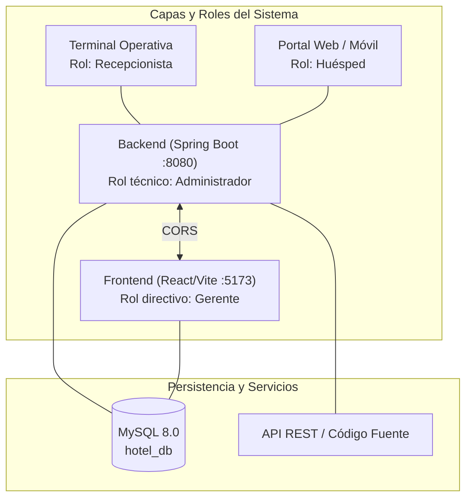

# Práctica: Autenticación, Manejo de Sesiones y Arquitectura de Roles

> Documento de referencia extraído del PDF de la práctica (**"Práctica: Autenticación y manejo de sesiones" — Ing. José Luis García Morales**) y del **Diagrama de Arquitectura y Roles del Sistema**, junto con la verificación de cumplimiento en el código actual de **Hotel Paraíso**.

---

## 1. Especificación del PDF: "Práctica: Autenticación y manejo de sesiones"

### 1.1 Objetivo
Implementar un sistema de autenticación seguro que permita:
- Registrar usuarios.
- Verificar sus cuentas por correo electrónico.
- Iniciar y cerrar sesión.
- Controlar el acceso a las secciones del sistema de reservaciones en línea según sus roles.

### 1.2 ¿Cómo debe funcionar?
1. **Iniciar sesión:** Si alguien intenta entrar a las reservaciones o secciones protegidas sin haber iniciado sesión, el sistema lo redirigirá a la página de acceso (`/login`). Si ya está registrado, ingresará su usuario (correo) y contraseña.
2. **Registrarse:** Si todavía no tiene una cuenta, podrá registrarse (`/registro`) proporcionando los datos solicitados: nombre, correo electrónico y contraseña.
3. **Verificar el correo:** Después del registro, el sistema enviará un correo con un enlace/código de confirmación. El usuario deberá confirmar para activar su cuenta. **Si no verifica su correo, no podrá iniciar sesión.**
4. **Controlar el acceso:** Cada tipo de usuario tendrá permisos diferentes (por ejemplo, un huésped realiza reservaciones, mientras que el personal administrativo gestiona habitaciones, reservaciones y usuarios).
   - **Regla crítica del PDF:** *"¡Importante! No basta con ocultar una sección en la interfaz. El servidor también debe comprobar que cada usuario tenga permiso para acceder a ella. Además, nunca almacenen contraseñas en texto plano ni publiquen credenciales en GitHub."*

### 1.3 Requisitos Técnicos del PDF
- **Contraseñas seguras:** Almacenarlas mediante un mecanismo de hash como **BCrypt**; nunca en texto plano.
- **Envío de correos:** Utilizar Gmail (SMTP) para enviar los enlaces/códigos de verificación. No publicar contraseñas ni credenciales en GitHub; utilizar variables de entorno (`.env`).
- **Autenticación:** Utilizar **JWT (JSON Web Tokens)** para identificar al usuario y controlar el acceso a los recursos protegidos.
- **Roles y permisos:** Definir los tipos de cuenta y las secciones a las que podrá acceder cada uno (tanto en Frontend como en Backend).
- **Pruebas:** Utilizar **Postman** para comprobar el registro, la verificación del correo, el inicio de sesión y el acceso a las rutas protegidas.

### 1.4 Entregables solicitados en el PDF
1. **Evidencias de funcionamiento:** Capturas de pantalla del registro, correo de verificación, inicio de sesión y acceso a las diferentes secciones.
2. **Colección de Postman:** Con las solicitudes necesarias para probar los principales casos de uso.
3. **Documento breve de pruebas:** Que incluya los casos exitosos y los casos de error (por ejemplo, intentar iniciar sesión sin verificar el correo).

---

## 2. Especificación de la Imagen: Arquitectura y Modelo de 4 Roles

El diagrama arquitectónico define un **Conjunto de servidores** interconectados bajo el siguiente esquema:

### 2.1 Componentes de Arquitectura en la Imagen
1. **Separación Backend ↔ Frontend con CORS:**
   - **Backend** (servidor Spring Boot en puerto `8080`) y **Frontend** (aplicación React + Vite en puerto `5173`) desacoplados y comunicados mediante política **CORS** configurada en el servidor.
2. **Base de Datos MySQL:**
   - Motor relacional **MySQL 8** (`hotel_db`) gestionado con migraciones **Flyway** (`V1` a `V11` + `R__seed_catalogo_inicial.sql`).
3. **Los 4 Roles Oficiales del Sistema:**
   - **Administrador (`ADMINISTRADOR`):** Gestión total de TI/sistema, usuarios, consultas SQL, catálogos maestros (hoteles, tipos de habitación), habitaciones, reservaciones, informes y dashboard.
   - **Gerente (`GERENTE`):** Supervisión ejecutiva y financiera (Dashboard de KPIs, Informes ejecutivos, reversión de No-Show, gestión operativa de reservaciones, habitaciones y catálogos de hoteles y categorías, sin acceso a consola SQL ni administración de cuentas de usuario).
   - **Recepcionista (`RECEPCIONISTA`):** Operación de mostrador (Reservaciones, confirmación de anticipos 50%, Check-in, Check-out, No-Show y cambio rápido de estado de habitaciones).
   - **Huésped (`HUESPED`):** Portal comercial web/móvil (Explorar hoteles y suites, cotizar, crear pre-reservas, ver "Mis Reservaciones", cancelar bajo política escalonada y editar "Mi Perfil").

---

## 3. Verificación: Cumplimiento del Proyecto contra el PDF y la Imagen

### 3.1 Matriz de Cumplimiento contra el PDF

| Requisito del PDF | Estado | Implementación actual en el proyecto |
| :--- | :---: | :--- |
| **1. Redirección a Login e Inicio de Sesión** | **Cumple (100%)** | `App.jsx` redirige rutas protegidas a `/login` si no hay sesión. `POST /api/auth/login` en `AuthController.java` y `AuthService.java` valida credenciales y devuelve el JWT y perfil del usuario. |
| **2. Registro de nuevos usuarios** | **Cumple (100%)** | Pantalla `/registro` (`RegisterPage.jsx`) y endpoint `POST /api/auth/registro`. Valida política de contraseña ($\ge 8$ caracteres, mayúscula, minúscula y número) y asigna siempre rol `HUESPED` con `verificado = false`. |
| **3. Verificación por correo (bloqueo de login si no verifica)** | **Cumple (100%)** | `EmailService.java` envía correo HTML vía Gmail SMTP con código de 4 dígitos y botón con enlace a `/verificar-correo?token=...`. Si `verificado == false`, `AuthService.login()` devuelve `403 Forbidden` con `requiereVerificacion: true` y la interfaz ofrece ingresar el código o reenviarlo. |
| **4. Contraseñas seguras con BCrypt** | **Cumple (100%)** | `SecurityConfig.java` registra `BCryptPasswordEncoder(12)` (fuerza 12). La tabla `usuario` almacena únicamente `password_hash`. |
| **5. Variables de entorno y protección en GitHub** | **Cumple (100%)** | `application.properties` importa `.env` (`DB_*`, `JWT_SECRET`, `MAIL_USERNAME`, `MAIL_PASSWORD`, `GEMINI_API_KEY`, `OLLAMA_BASE_URL`). `.gitignore` excluye `.env` y se incluye `.env.example` sin secretos. |
| **6. Autenticación con JWT y Logout seguro** | **Cumple (100%)** | `JwtService.java` firma tokens HMAC-SHA256 (`jjwt 0.12.6`) con `sub`, `rol`, `ver` y `jti`. `JwtAuthenticationFilter.java` y `TokenBlacklistService.java` (tabla `token_revocado`) invalidan tokens al cerrar sesión (`POST /api/auth/logout`) o cambiar contraseña. |
| **7. Control de acceso por roles en Frontend y Backend** | **Cumple (100%)** | **Backend:** `SecurityConfig.java` y `@PreAuthorize` restringen cada endpoint por rol (`401` sin token, `403` sin permiso). **Frontend:** `App.jsx` y `AdminLayout.jsx` filtran pestañas y bloquean rutas no autorizadas según el rol. |
| **8. Entregable 1: Evidencias (Capturas)** | **Cumple (100%)** | Existen 45 capturas en `docs/capturas/` (escritorio `1440px`, tablet `1024px` y móvil `390px`) cubriendo login, registro, portal de huésped y módulos administrativos. |
| **9. Entregable 2: Colección de Postman** | **Cumple (100%)** | `docs/postman/Hotel_Auth_Collection.json` incluye pruebas automatizadas completas para registro, verificación de correo, login y control de acceso de los **4 roles** (`ADMINISTRADOR`, `GERENTE`, `RECEPCIONISTA` y `HUESPED`), IA (`/api/v1/chat`) y revocación de JWT en logout. |
| **10. Entregable 3: Documento breve de pruebas** | **Cumple (100%)** | `docs/REPORTE_PRUEBAS_AUTENTICACION.md` documenta la configuración con **MySQL 8.0 (`hotel_db`)**, las 4 cuentas semilla y la matriz completa de casos de prueba CP-01 a CP-14. |

---

### 3.2 Matriz de Cumplimiento contra la Imagen (Arquitectura y 4 Roles)

| Componente / Rol de la Imagen | Estado | Implementación y Permisos Verificados |
| :--- | :---: | :--- |
| **Backend (`:8080`) ↔ Frontend (`:5173`) + CORS** | **Cumple (100%)** | `SecurityConfig.corsConfigurationSource()` habilita CORS (`GET, POST, PUT, PATCH, DELETE, OPTIONS`, header `Authorization`), permitiendo la comunicación entre React (`:5173`) y Spring Boot (`:8080`). |
| **Base de Datos MySQL** | **Cumple (100%)** | Conectado a `jdbc:mysql://localhost:3306/hotel_db` con 11 migraciones Flyway (`V1` a `V11`) y catálogo semilla repetible (`R__seed_catalogo_inicial.sql`). |
| **Rol 1: `GERENTE`** (`gerente@hotelparaiso.com` / `Gerente1234!`) | **Cumple (100%)** | **Único rol con acceso a información monetaria/financiera y usuarios.** Tiene acceso a las **8 pestañas** de `AdminLayout` (`Dashboard`, `Informes`, `Reservaciones`, `Habitaciones`, `Hoteles`, `Categorías`, `Consultas SQL` y `Usuarios`). En backend es el único autorizado para `/api/dashboard/**`, `/api/informes/**`, `/api/usuarios/**`, `/api/consultas/habitaciones/ingreso-potencial` y herramientas financieras de IA (`EstadisticasTool`, `sumIngresoPotencial`). |
| **Rol 2: `ADMINISTRADOR`** (`admin@hotelparaiso.com` / `Admin1234!`) | **Cumple (100%)** | Gestión técnica de inventario e infraestructura con **5 pestañas** (`Reservaciones`, `Habitaciones`, `Hoteles`, `Categorías`, `Consultas SQL`). **Tiene bloqueados `/dashboard`, `/informes`, `/usuarios` y toda la información monetaria del hotel** tanto en frontend como en backend (`403 Forbidden`) y en las herramientas de IA. |
| **Rol 3: `RECEPCIONISTA`** (`recepcion@hotelparaiso.com` / `Recep1234!`) | **Cumple (100%)** | Al iniciar sesión entra a `/reservas`. Solo ve **2 pestañas**: `Reservaciones` y `Habitaciones`. Si navega a `/dashboard`, `/informes`, `/usuarios` o `/consultas`, tanto el frontend (*"Módulo restringido para Recepción"*) como el backend (`403 Forbidden`) bloquean el acceso. |
| **Rol 4: `HUESPED`** (`huesped@hotelparaiso.com` / `Huesped1234!`) | **Cumple (100%)** | Utiliza la superficie `GuestLayout` (`/portal-huesped`, `/mis-reservas`, `/experiencias`, `/mi-perfil`). Solo puede crear pre-reservas propias, ver sus itinerarios y cancelar sus propias reservas. Cualquier intento de invocar rutas de staff devuelve `403 Forbidden`. |
| **Modelo IA Ollama (`llama3.1`)** | **Cumple (100%)** | `src/main/resources/application.properties` (`spring.ai.ollama.chat.model=llama3.1`) y `OllamaToolCallingAdvisor.java` configurados con `llama3.1`. |
